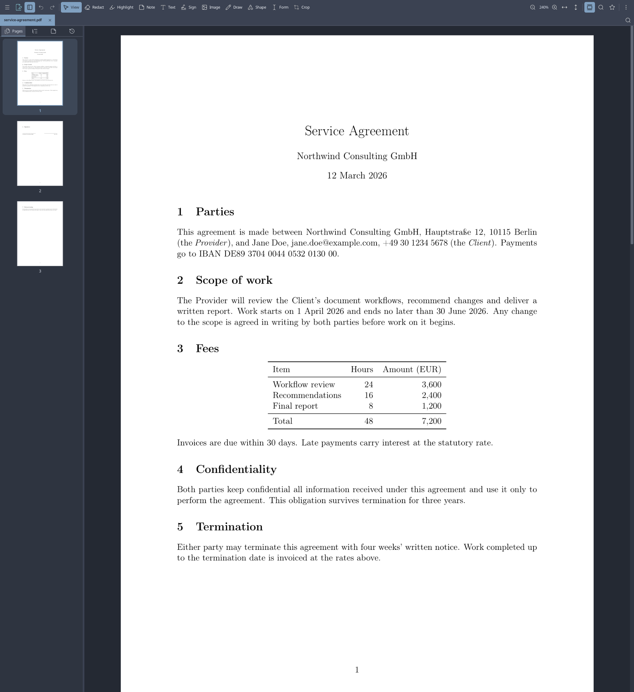

# cuttle

A PDF viewer and editor for Linux, macOS, Windows and Android, with a command line for scripts and agents.



## Dependencies

| Library | Version | Used for | License |
| --- | --- | --- | --- |
| [MuPDF](https://mupdf.com) | 1.28 | reading, rendering, editing, search, OCR (with its bundled [Tesseract](https://github.com/tesseract-ocr/tesseract) and Leptonica) | AGPL-3.0 (or commercial) |
| [OpenSSL](https://www.openssl.org) (`libcrypto`) | 3.5 | certificate signatures | Apache-2.0 |
| [raylib](https://www.raylib.com) | 6.2 | the window (optional: without it only the commands are built) | zlib |
| [raygui](https://github.com/raysan5/raygui) | 5.0 | widgets | zlib |
| [fontconfig](https://www.freedesktop.org/wiki/Software/fontconfig/) | system | system fonts on Linux | MIT-style |

The program's license follows MuPDF's: raylib's and raygui's zlib license, OpenSSL's and Tesseract's Apache-2.0, Leptonica's
BSD-style and fontconfig's MIT-style licenses are permissive and impose nothing on it.

## Features

- **Redact**: the text, images and drawings under each mark are removed, not covered. Find personal data
  (e-mails, phone numbers, IBANs, card numbers, dates, ID numbers) and mark it in one go. Saving also scrubs
  metadata, attachments, scripts, hidden text and thumbnails.
- **Edit**: highlight and other marks, notes, text, images, drawings, shapes, forms, crop, rotate, reorder,
  insert and remove pages, Bates numbers, watermarks, document properties, outline.
- **Make forms**: start from a blank PDF or any PDF and add fillable text fields, checkboxes, radio buttons,
  dropdowns and signature fields that others can fill in any PDF viewer.
- **Sign**: a picture of your signature, or a digital certificate signature (.p12).
- **More**: OCR (Tesseract), compare two PDFs, combine and split, export pages as PDF or images, protect with a
  password, print. Undo and redo, find with regular expressions (JavaScript syntax) or ignoring accents, in one tab or all, two pages
  side by side, presentation mode (F5).
- **Read**: line numbers in the margins as LaTeX's lineno sets them (through the document, per page, or relative to
  the vim caret); a preview of where a link leads when resting on it; Back and Forward (Alt+Left/Right, mouse side
  buttons) after following links; pinch to zoom on touchpads; the last session's tabs reopen at startup
  (`reopen_tabs`). Shift+drag selects whole lines (a table's rows across their cells). Margin notes, list and
  reference labels and slanted table headers are handled when numbering and selecting.
- **Keys**: every shortcut can be changed in Menu > Keyboard shortcuts... (searchable, warns about clashes),
  kept in `~/.config/cuttle/keys.toml`.
- **Vim keys** (View > Vim keys): a caret on the text, always there, moved by h/j/k/l, w/b/e, 0/$, gg/G, 12G and
  Ctrl+d/u (the view follows; Ctrl+e/y scroll it alone; on pages without text the keys scroll); / and n/N; `v`/`V`
  select by character or line to copy (`y`) or mark; the tools move behind the leader (Space h = Highlight).
  Everything the window does works from the keyboard: `:` runs any action or command (`:w`, `:q`, `:42`,
  `:zoom 150`, `:set relativenumber`, `:colour #c62828`, with completion), `gt`/`gT` switch tabs, Space e moves
  into the sidebar, Space Shift+N/T/I/S put notes, text, images and signatures at the caret, Ctrl+V draws a box
  for shapes, crops and redactions, `]c`/`[c` go to the next and previous column, `]a`/`[a` select annotations to move (h/j/k/l), resize (H/J/K/L), edit (`i`) or delete (`dd`);
  Enter or Ctrl+] follows the link at the caret, Ctrl+o/Ctrl+i go back and forward (across files too); `ma` sets a
  mark (a bookmark called `a`; capitals work across files), `'a` and `` `a `` jump to its line or character; `*`/`#`
  find the word under the caret, `zz`/`zt`/`zb` place its line in the view, `viw`/`vip` select a word or paragraph. A mouse selection
  becomes a visual one. After a prefix (Space, `g`, `]`, `m`, `'`) a box lists the keys that can follow
  (`vim_key_hints`); the status line shows the mode and the caret's line : column.
  `g?` lists every key. Dialogs and menus work with Tab, arrows, Enter and Esc (F10 opens the menu).
- **LaTeX**: open PDFs reload when they change on disk; SyncTeX jumps between the PDF and the source.
- **Other documents**: XPS, comics (CBZ), images, SVG and e-books (EPUB, MOBI, FB2) open like PDFs; editing one
  makes a PDF copy, saved next to the original. Office files (DOCX, XLSX, PPTX) are for the commands only: MuPDF
  reads their text but not their layout (make a PDF with LibreOffice to view one).

## Install

Each release on the [releases page](../../releases) has a Linux AppImage and tarball, a macOS `.dmg`, a Windows
`.zip` and an Android APK, built on GitHub Actions when its tag `vX.Y.Z` is pushed; its notes are that version's
section of [CHANGELOG.md](CHANGELOG.md). Pull requests only build and test the app on Linux, macOS and Android
(Actions > CI > Run workflow does the same for any branch); Windows is built and tested only for a release.

### Linux

Both Linux downloads run on Ubuntu 24.04 and later, Arch and other distributions with glibc 2.39 or newer, and use
fontconfig and OpenGL from the system (installed on any desktop). Pick one:

- **AppImage**, one file:

  ```sh
  mkdir -p ~/.local/bin
  curl -fL https://github.com/vamsikalagaturu/cuttle/releases/latest/download/cuttle-x86_64.AppImage -o ~/.local/bin/cuttle
  chmod +x ~/.local/bin/cuttle
  ~/.local/bin/cuttle --install-desktop
  ```

- **Tarball**, for systems without FUSE, which the AppImage needs:

  ```sh
  mkdir -p ~/.local/opt ~/.local/bin
  curl -fL https://github.com/vamsikalagaturu/cuttle/releases/latest/download/cuttle-linux-x86_64.tar.gz | tar xz -C ~/.local/opt
  ln -sf ~/.local/opt/cuttle/bin/cuttle ~/.local/bin/cuttle
  ~/.local/bin/cuttle --install-desktop
  ```

`--install-desktop` adds cuttle to the applications menu and to "Open with" for PDFs. Run it again after moving the
program; `--uninstall-desktop` removes the entry. For plain `cuttle` commands, `~/.local/bin` must be on your `PATH`.

### macOS

The `.dmg` on the [releases page](../../releases) is for Apple Silicon Macs
with macOS 11 or later (on an Intel Mac, build it with `platform/macos/build.sh`).

1. Download `cuttle.dmg`, open it and drag **cuttle** onto **Applications**. Eject the disk image. To download
   from Terminal: `curl -fLO https://github.com/vamsikalagaturu/cuttle/releases/latest/download/cuttle.dmg`
2. Open the app the first time. It is not notarized by Apple, so macOS blocks the first start:
   - macOS 15 (Sequoia) and later: open cuttle from Applications, click **Done** on the warning, then go to
     **System Settings > Privacy & Security**, scroll to "cuttle was blocked", click **Open Anyway** and confirm
     with your password.
   - macOS 14 and earlier: Control-click (or right-click) cuttle in Applications, choose **Open**, then **Open**
     again.

   Or, in Terminal, clear the download flag once instead: `xattr -dr com.apple.quarantine "/Applications/cuttle.app"`.
3. To open PDFs with it by default: select a PDF in Finder, **File > Get Info**, under **Open with** pick cuttle,
   then **Change All...**.
4. For the command line (`cuttle info file.pdf`, ...), link the binary into your PATH:

   ```sh
   sudo mkdir -p /usr/local/bin
   sudo ln -sf "/Applications/cuttle.app/Contents/MacOS/cuttle" /usr/local/bin/cuttle
   ```

An update is the same: drag the new version onto Applications and replace the old one.

### Windows

`cuttle-windows.zip` is for 64-bit Windows 10 (version 1903) or 11.

1. Download it and unpack it anywhere, e.g. to `%LOCALAPPDATA%\Programs`, here in Command Prompt:

   ```bat
   curl -fLO https://github.com/vamsikalagaturu/cuttle/releases/latest/download/cuttle-windows.zip
   mkdir "%LOCALAPPDATA%\Programs"
   tar -xf cuttle-windows.zip -C "%LOCALAPPDATA%\Programs"
   ```

   The `cuttle` folder holds `cuttle.exe`, the OCR data and the Visual C++ runtime. The program is not signed,
   so SmartScreen may warn on the first start: **More info**, then **Run anyway**.
2. `"%LOCALAPPDATA%\Programs\cuttle\cuttle.exe" --install-desktop` adds cuttle to "Open with" for PDFs
   (`--uninstall-desktop` removes it); to make it the default, pick it under **Open with > Choose another app** with
   **Always** ticked.
3. For the command line, add the folder to your PATH.

Settings are in `%APPDATA%\cuttle`, reading positions and window messages in `%LOCALAPPDATA%\cuttle`.

## Build

```sh
platform/linux/build.sh      # ~/.cache/cuttle/linux/out/cuttle-<arch>.AppImage and cuttle-linux-<arch>.tar.gz
platform/macos/build.sh      # ~/Library/Caches/cuttle/macos/out/cuttle.dmg
platform/android/build.sh    # ~/.cache/cuttle-native/android/out/cuttle.apk (details: platform/android/README.md)
platform/windows/build.sh    # in Git Bash: ~/.cache/cuttle/windows/out/cuttle-windows.zip
```

Each `build.sh` first runs the `deps.sh` next to it, which downloads and builds the third-party libraries and
skips what is already built; `build.sh check` builds and tests without packing (on Android: compiles the native
library, no APK).

The Windows script needs Visual Studio 2022 or 2026 with the C++ tools and Strawberry Perl, as on GitHub's
`windows-latest` runner; it builds MuPDF through its Visual Studio solution and everything else with MSVC.

The builds leave out MuPDF's CJK and Noto fallback fonts: text in a font a PDF does not embed is drawn with the
system's fonts (fontconfig, /system/fonts, the macOS and Windows font folders). `PT_FONTS=full` before any of the
scripts bundles them as well, for a larger program that needs no installed fonts.

On Linux the script builds one `cuttle` binary (`~/.cache/cuttle/linux/build/cuttle`), with its
dependencies linked in except fontconfig, OpenGL and the window system's libraries, and packs it with the English
OCR data, man page and icon as the AppImage and the tarball. Both run on the build machine's glibc or newer, so
release builds come from Ubuntu 24.04. To install the binary instead, with its man page, desktop entry, icon and OCR data:

```sh
platform/linux/build.sh install ~/.local
```

The scripts download and build the pinned dependencies ([MuPDF](https://mupdf.com) with
[Tesseract](https://github.com/tesseract-ocr/tesseract), [OpenSSL](https://www.openssl.org), [raylib](https://www.raylib.com) and [raygui](https://github.com/raysan5/raygui))
and run the tests. On Debian/Ubuntu the Linux script needs `build-essential cmake pkg-config curl git libfontconfig-dev
libx11-dev libxrandr-dev libxinerama-dev libxcursor-dev libxi-dev libgl1-mesa-dev libegl-dev libxkbcommon-dev
libwayland-dev wayland-protocols`.

**Building against installed libraries.** If MuPDF 1.28, OpenSSL (`libcrypto`) and
[fontconfig](https://www.freedesktop.org/wiki/Software/fontconfig/) are already installed where pkg-config finds
them, and raylib 6.2 is installed where `CMAKE_PREFIX_PATH` can point, you can skip the scripts and build with CMake
directly:

```sh
cmake -S . -B build -DCMAKE_PREFIX_PATH=/path/to/raylib && cmake --build build && ctest --test-dir build
cmake --install build --prefix ~/.local
```

Without raylib, `cuttle` is built with the commands only.

## Usage

```sh
cuttle file.pdf                          # open in the window
cuttle redact in.pdf -o out.pdf --text "Jane Doe" --regex 'DE\d{20}'
cuttle info in.pdf
cuttle convert book.epub -o book.pdf     # any supported document to PDF
cuttle COMMAND --help
cuttle --version
```

Commands print one JSON object and exit with a meaningful code; `cuttle --help` lists them,
`AGENTS.md` (`cuttle help`) explains their conventions and exit codes. Others: `search`,
`render`, `annotate`, `draw`, `insert-text`, `insert-image`, `sign`, `bates`, `watermark`, `ocr`, `compare`,
`export-images`, `scrub`, `inspect`, `comments` (annotations with page and line numbers, as Markdown or JSON).

- Settings: `~/.config/cuttle/settings.toml`, on Windows `%APPDATA%\cuttle\settings.toml` (e.g.
  `editor_command = "code -g %f:%l"` for SyncTeX).
- OCR needs Tesseract's `LANG.traineddata` in `$TESSDATA_PREFIX`, `$XDG_DATA_HOME/cuttle/tessdata` or the
  system's data folders; the Linux tarball, the macOS app, the Windows zip and the APK include English.
- LaTeX: compile with `-synctex=1`. Ctrl+click in the PDF opens the source line in your editor;
  `cuttle --forward file.pdf LINE file.tex` shows a source line in the PDF.
- Interface size: View > Appearance > Interface size, or Ctrl+Alt++ / Ctrl+Alt+- (Ctrl+Alt+0: automatic); saved as
  `ui_scale` in the settings.
- Theme: Nord, dark by default. The menu's Dark / Light / System (System follows the desktop) is `scheme` in the
  settings' `[theme]` table. Its colours come from the desktop theme's
  `~/.local/state/omarchy/current/theme/colors.toml` when there is one, and each of its 13 roles (`accent`,
  `background`, `foreground`, `blue`, ...) can be set there as `#rrggbb`, as in jackdaw and ferret.
- Logging: `CUTTLE_LOG=error|warn|info|debug`.

### Updates

At startup, at most once a day, the window asks GitHub for the latest release
(`https://api.github.com/repos/vamsikalagaturu/cuttle/releases/latest`, with a `cuttle/VERSION` user agent
and nothing else). When it is newer, a bar offers **Update**: it downloads that release's package for this install,
checks it against the SHA-256 digest GitHub lists for it, and replaces the AppImage, the tarball's folder, the macOS
app or (after the app closes) the Windows folder; on Android the system installer takes the APK. A
`build.sh install PREFIX` that you can write (e.g. `~/.local`) gets the tarball's files put over its own one by one
(the program, `share/cuttle`, the man page, the launcher entry and icon; nothing else in the prefix is touched,
and a launcher entry keeps its `Exec=` line). Installs the app cannot replace itself (a distro package, a prefix
such as `/usr/local` you may not write, a folder it may not write) get the release page instead. Menu > About cuttle has Check for updates, and its Check for updates at startup
(`check_updates` in the settings) turns the daily check off. Desktop downloads go through the system's `curl`. `cuttle update` does the same
without the window (`--check` only reports, `--force` also replaces a development build); it is the only command that
uses the network.

## Safety

Check redacted files before sharing them. A picture signature is not a cryptographic one; use a certificate for
that. Passwords given on the command line can show in process listings.

**License:** AGPL-3.0-or-later, as [MuPDF](https://mupdf.com/licensing) (see [Dependencies](#dependencies)).
